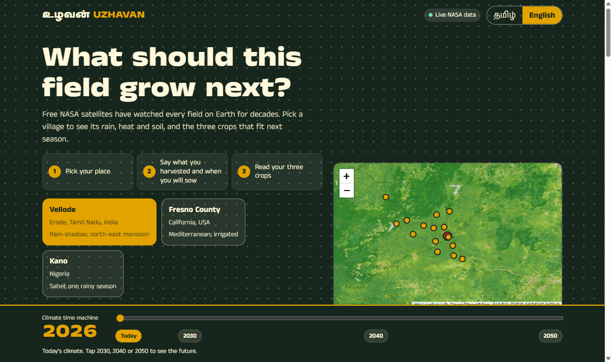
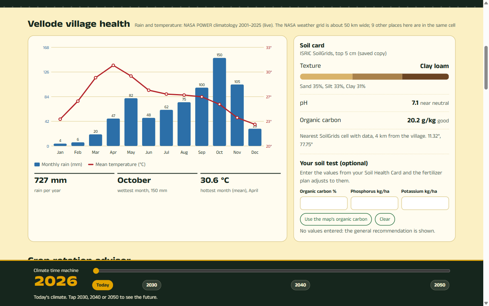
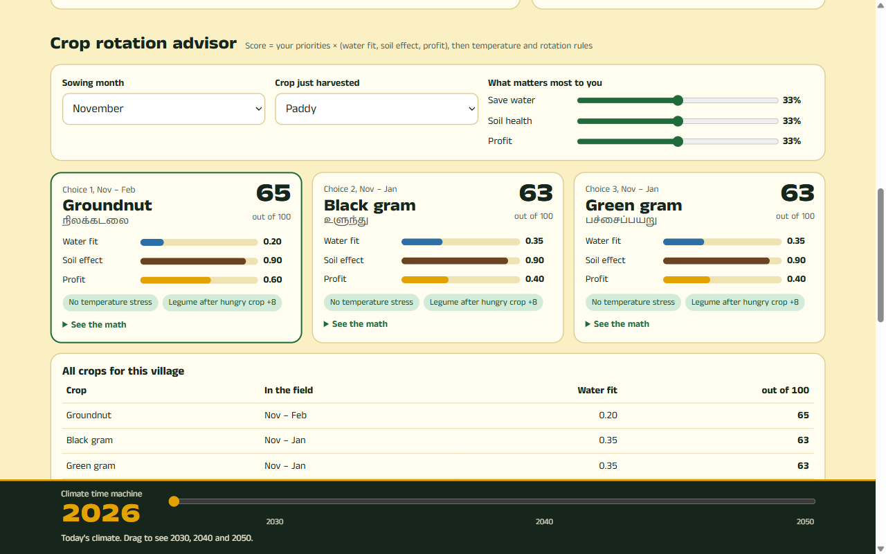
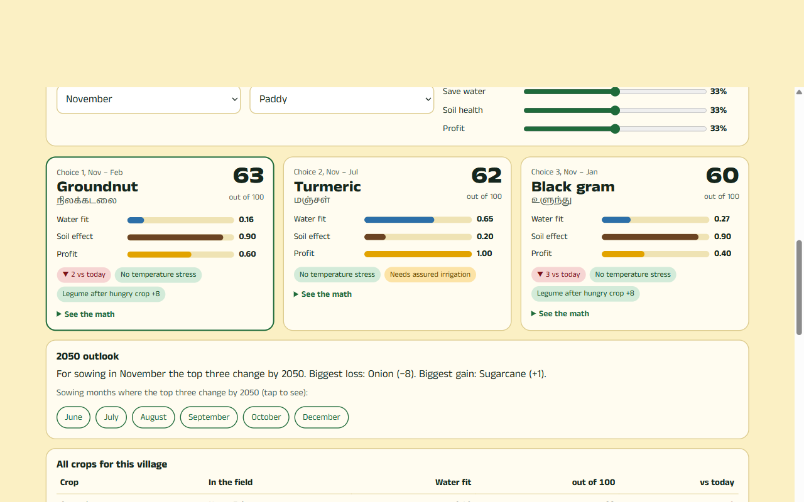
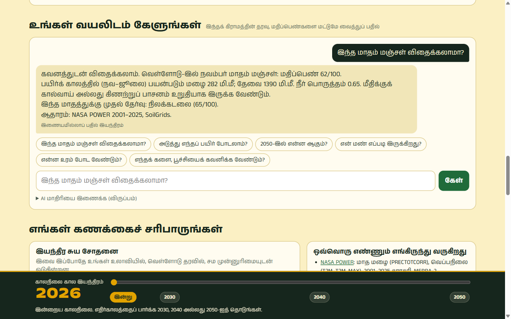
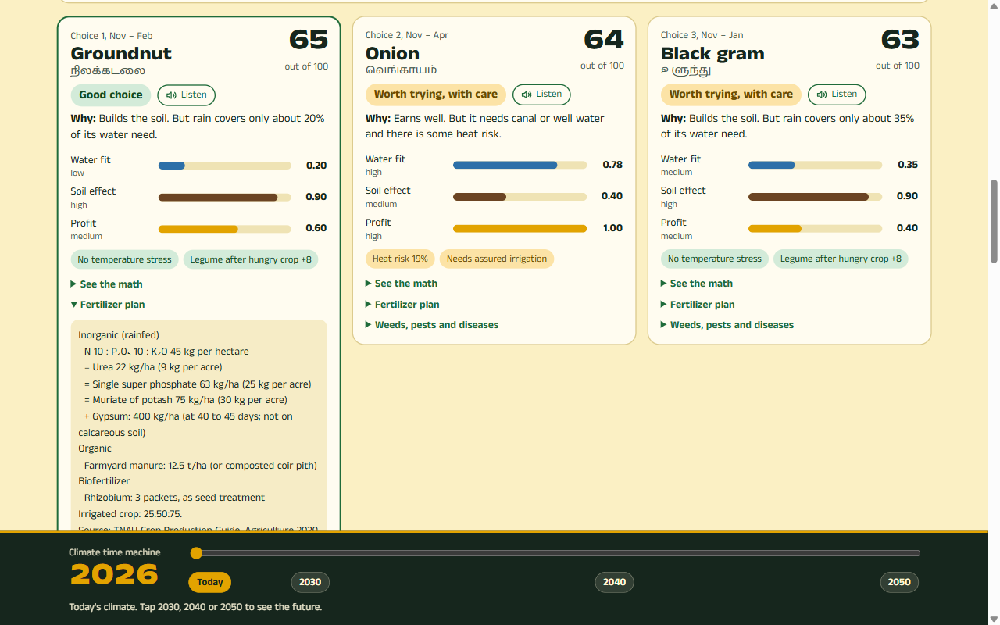
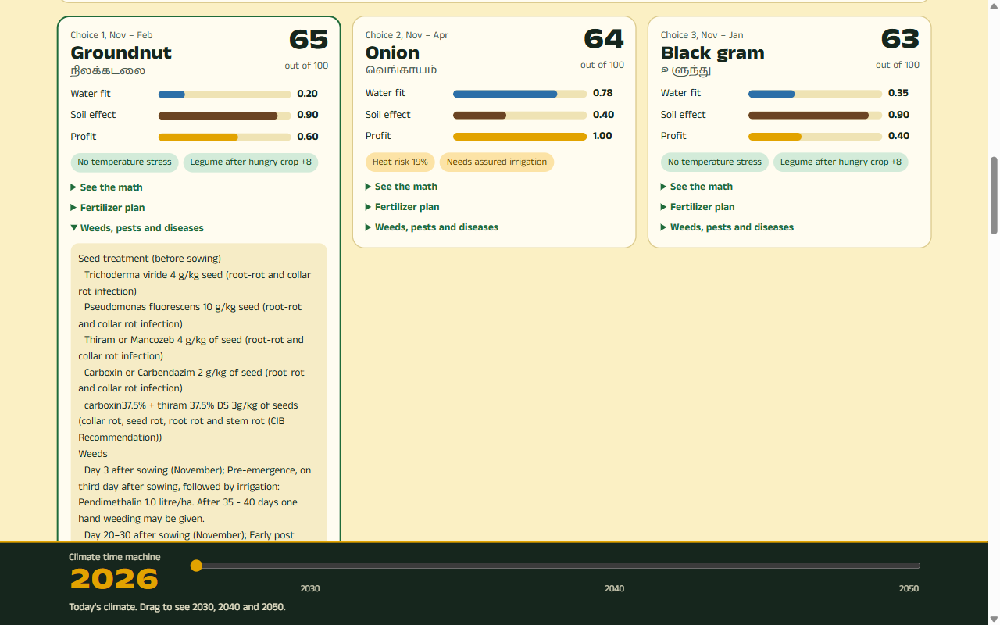

<h1 align="center">UZHAVAN &nbsp;உழவன்</h1>

<p align="center"><b>Which crop next, why, and will it still work in 2050?</b><br>
A free Tamil and English web page for farmers, built on open NASA data.</p>

<p align="center">
  <a href="https://amalnathkp13-boop.github.io/uzhavan/"></a>
  
  
  
</p>

<p align="center">
  <a href="https://amalnathkp13-boop.github.io/uzhavan/"><b>Open the live site</b></a> &nbsp;·&nbsp;
  <a href="SUBMISSION.md">Submission pack</a>
</p>

<p align="center">
  <a href="https://amalnathkp13-boop.github.io/uzhavan/"></a>
</p>

## Why

A farmer has to choose the next crop months before knowing how the season will go, and the rain is changing. NASA has free data on the rain, heat and soil of every field on Earth, but it sits behind technical websites, in English, in units nobody farms in.

UZHAVAN ("The Farmer") puts it on one screen, in Tamil. It was built for the NASA Space Apps Challenge 2026, challenge "Field Shift: Adapting Farms with NASA Data".

## At a glance

| | |
|---|---|
| **Places** | 16 in Erode district (India), plus Fresno County (USA) and Kano (Nigeria). Tap the map for anywhere else |
| **Crops** | 18, each with water need, temperature range, soil effect and profit rank |
| **Languages** | Tamil first, English with one tap |
| **Climate** | Today, 2030, 2040 and 2050, from five NASA NEX-GDDP-CMIP6 models |
| **Runs on** | Any phone or laptop browser. One file, no login, no key. Once loaded, it keeps working if the connection drops |

## What a farmer gets

<table>
<tr>
<td width="50%"><br><b>1. Village health.</b> Monthly rain and temperature from NASA POWER, and a soil card from ISRIC SoilGrids.</td>
<td width="50%"><br><b>2. Crop rotation advisor.</b> The three best crops, each with a score out of 100, a plain verdict and a one-line reason.</td>
</tr>
<tr>
<td><br><b>3. Climate time machine.</b> Tap 2050: the climate shifts and the crops are re-ranked, with points gained or lost against today.</td>
<td><br><b>4. Ask your field.</b> Questions in Tamil or English, answered only from that village's numbers.</td>
</tr>
<tr>
<td><br><b>5. Fertilizer plan.</b> The published dose for each crop, as kilos of urea, super phosphate and potash per acre, plus manure and biofertilizer.</td>
<td><br><b>6. Weeds, pests and diseases.</b> Seed treatment, weed killers by day after sowing, and pest controls, with chemicals India has banned taken out.</td>
</tr>
</table>

## How to use it

1. **Pick your place.** One of the three pilot villages, one of 15 more places in Erode district, or any point on the map.
2. **Say what you harvested and when you will sow.** Then slide the three priorities: save water, soil health, profit.
3. **Read your three crops.** Each card says "Good choice", "Worth trying, with care" or "Not a good fit now", and why.

Every card opens to show its arithmetic, its fertilizer plan and its weed and pest calendar.

## What makes it different

- **Plain words first.** A verdict and a reason on every card, low / medium / high beside every number, and a Listen button where the device has a voice.
- **Nothing is hidden.** Every score opens to show the sum behind it and where each figure came from.
- **The farmer's priorities are the formula.** The three sliders are the weights in the score.
- **It does not break.** If the connection drops, it carries on with saved NASA data and still answers questions.
- **It checks itself.** Three tests of the scoring engine run in the browser every time the page loads.

## How the score works

Three ingredients, each from 0 to 1: **water fit** (does rain, plus irrigation for irrigated crops, cover the crop's water need), **soil effect** (pulses build the soil, paddy and sugarcane drain it) and **profit** (a five-step rank from published figures). The farmer's sliders weight them. Heat or cold outside the crop's comfortable range lowers the score, and repeating the same plant family costs 50 points.

<details>
<summary><b>The formula and the built-in tests</b></summary>

```
water fit = min(1, (0.7 x season rain + irrigation top-up) / crop water need)
            irrigation top-up = 45% of need, for irrigated crops only
base      = weighted mean of water fit, soil effect, profit (weights = the sliders)
score     = 100 x base x (1 - 0.6 x temperature stress) - 50 if same family as last crop
            + 8 if a legume follows an exhausting crop
temperature stress = 0 while the mean temperature over the crop's months in the field is
            inside the crop's optimal range; rises to 1 at the crop's absolute limit
            (heat above the range, cold below it)
```

Profit is a rank from 1 to 5: 5 if the crop earns at least half of the village's best crop, 4 at least a quarter, 3 an eighth, 2 a sixteenth, otherwise 1.

The "Check our work" panel runs three tests in the browser on the Vellode data: turmeric in June after paddy (water fit 0.73, about 65), black gram in October after paddy (about 74), paddy after paddy (0). The playbook's rehearsal figure for turmeric was 58, with an estimated profit rank of 4; the published figures put turmeric at 5, which gives 65.

</details>

## Data

| | Source | Used for |
|---|---|---|
| NASA | **POWER** climatology (MERRA-2, 2001-2025) | Monthly rain and temperature, called live |
| NASA | **GPM IMERG** V07, through SERVIR ClimateSERV | Telling the rain of nearby Erode places apart (about 10 km) |
| NASA | **NEX-GDDP-CMIP6**, SSP2-4.5, five models | The 2030, 2040 and 2050 climate |
| NASA | **GIBS**: MODIS NDVI, **SMAP** soil moisture, **NISAR** radar (NASA + ISRO) | Three selectable satellite layers on the map |
| NASA | **SMAP** soil moisture, 2015-2025 | Soil moisture at the sowing month, on the soil card |
| ISRIC | **SoilGrids** v2.0 | Soil texture, pH and organic carbon |
| TNAU, FAO | Crop water tables, **EcoCrop**, Crop Production Guide 2020 | Water need, temperature ranges, fertilizer, weeds and pests |
| Govt of India, Fresno County, IITA | Cost of cultivation, crop report, field study | Profit rank |

<details>
<summary><b>Every source, with how it is used</b></summary>

| Source | Used for | How |
|---|---|---|
| NASA POWER climatology API (MERRA-2, 2001-2025) | Rain (PRECTOTCORR), temperature (T2M) | Live call, saved copy as fallback |
| ISRIC SoilGrids v2.0 | Texture, pH, organic carbon, 0-5 cm | Live call, saved copy as fallback. Vellode and Kano use the nearest cell that has data |
| NASA GIBS, MODIS Terra NDVI 8-day | Greenness layer on the map | Live tiles |
| NASA NEX-GDDP-CMIP6 (NCCS THREDDS) | Time machine | Daily `tas` and `pr` at each place's grid cell, SSP2-4.5, 2001-2055. Per model, monthly change of 2026-2035, 2036-2045 and 2046-2055 against that model's 2001-2025; then the mean across models, added to the POWER baseline. Years in between are interpolated. Rain is left unchanged in months where a model's own baseline is under 5 mm. The model list is shown on the page |
| NASA GPM IMERG V07 Late, via NASA SERVIR ClimateSERV | Rain for the Erode places | Daily 0.1-degree rainfall, 2001-2025. Each month's POWER rain is multiplied by the place's IMERG rain over a reference (Vellode's IMERG rain inside Vellode's POWER cell, the cell average elsewhere) |
| TNAU Agritech water-requirement table; TNAU ARS Bhavanisagar (turmeric) | Water need and duration for Tamil Nadu crops | Typed into the crop table |
| FAO Irrigation Water Management Training Manual 3, Tables 4-5 | Water need and duration for the other crops | Midpoint of the published range |
| FAO EcoCrop | Optimal and absolute temperature ranges | Typed into the crop table |
| Govt of India DES, cost of cultivation estimates 2021-22 (Tamil Nadu) | Profit rank, Vellode: paddy, maize, sorghum, green gram, black gram, groundnut, cotton, onion, sugarcane | Net return per hectare = value of produce minus cost A2+FL. Turmeric comes from a separate Coimbatore study (Govindasamy et al. 2021); sesame has no figure |
| Statistical Hand Book of Tamil Nadu 2022-23, Table 5.4; TRS report 2021-22 (onion) | Irrigated flag, Vellode: paddy, sorghum, sugarcane, cotton, groundnut, onion | Irrigated when more than half the crop's area is irrigated |
| Fresno County Crop & Livestock Report 2025; UC Davis 2026 blackeye cost study | Profit rank, Fresno | Gross value per harvested acre (not net) |
| USDA Census of Agriculture 2022, Fresno County | Irrigated flag, Fresno: cotton, alfalfa, maize, wheat | Irrigated share of harvested acres |
| IITA KKM baseline (Ayanwale et al. 2011), Bunkure, 2008; Sufiyan et al. 2022 | Kano: order of millet, sorghum, maize, cowpea, groundnut; which crops are rain-fed or dry-season irrigated | Gross margin per hectare; the five are ranked against each other with groundnut held at 3 |
| FAO Fertilizer and Plant Nutrition Bulletin 16, Tables 22 and 29, chapter 8 | Soil effect classes | Legumes fix nitrogen, other crops draw nutrients down. The 0-1 value per class is the team's |
| TNAU Crop Production Guide 2020 (Agriculture, Horticulture) | Fertilizer plan, Vellode: all 11 crops | N, P2O5, K2O, farmyard manure, biofertilizer, timing. Rainfed dose for rainfed crops, with the irrigated dose in a note |
| CDFA FREP California Fertilization Guidelines; Tyler et al. 1988 (garlic); UC Davis 2026 blackeye study | Fertilizer plan, Fresno | Converted from lb/acre. Mostly ranges that depend on yield or soil test |
| Nigeria FMARD 2015 recommendation via the IFDC AfricaFertilizer review 2018; NAERLS bulletins 239 and 242; STDF/NEPC sesame farmers' guide 2014; ICRISAT handbooks 2020 | Fertilizer plan, Kano: all 10 crops | N, P2O5, K2O; manure for millet, sorghum, groundnut and sesame |
| CDFA Healthy Soils Program compost white paper; CDFA FREP tomato brochure | Fresno compost rate; processing-tomato season nitrogen | 3 to 5 tons/acre of compost a year for annual crops; about 175 lb N/acre |
| ICAR, Indian Farming 70(3):18-21, 2020 | Soil-test adjustment at Vellode | Low fertility +25%, high -25%, with the class limits |
| TNAU Crop Production Guide 2020; PPQS / CIB&RC list of banned and restricted pesticides (31.10.2026) | Weeds, pests and diseases, Erode-district crops | Herbicides, pest and disease controls and seed treatment as printed; banned and restricted chemicals removed |
| NASA SMAP L4 root-zone soil moisture; NISAR radar backscatter (NASA + ISRO), both through NASA GIBS | Selectable map layers | Shown as imagery: SMAP for the latest day, NISAR for a pass over each region (Erode 10 November, Fresno 14 October, Kano 22 September 2026). They do not yet enter the crop score |
| NASA SMAP soil moisture (NSIDC SMAP/Sentinel-1 1 km), via NASA SERVIR ClimateSERV | Soil moisture on the soil card | Monthly average 2015-2025 at each place, shown for the sowing month with a 12-month strip. Kano is outside that product and uses the NASA-USDA Enhanced SMAP surface soil moisture (10 km, mm, 2015 to August 2022) from the same service. Shown for information; not in the score |

</details>

## Honest limits

- The 2050 view is a **scenario, not a forecast**: climate-model changes applied to today's average climate. The projected change is modest, about +0.9 °C at Vellode.
- Some values are still the **team's estimates** because no published figure was found. The "See the math" panel on each card marks every one.
- Fertilizer plans are the **general published dose**. At the Erode places a farmer can enter Soil Health Card values to adjust them.
- The weed and pest schedules come from a **2020 guide**, filtered against India's banned and restricted list of October 2026. The page tells the farmer to check the label and ask the agricultural officer. They cover the Erode crops only.


## Run it yourself

It is one file, `index.html`. No build step, no key, no login.

```bash
python -m http.server 8765
```

Then open http://localhost:8765. The live site is served by GitHub Pages from the `main` branch root.

<details>
<summary><b>Reproduce the climate projections</b></summary>

`python tools/fetch_nex.py` pulls the daily NEX-GDDP-CMIP6 series for the ten grid cells (5,500 point requests; it can be stopped and resumed) into `tools/nex_cache.json`. `python tools/nex_deltas.py index.html` turns that cache into the monthly changes and writes them into the `NEX` constant in `index.html`.

</details>

## Team

[amalnathkp13-boop](https://github.com/amalnathkp13-boop) · [deexithamde](https://github.com/deexithamde) · [Bairavi Alagesan](https://github.com/bairavialagesan123-lgtm) · [hariprasanna4047-jpg](https://github.com/hariprasanna4047-jpg) · [jeevanandham2428-bit](https://github.com/jeevanandham2428-bit) · [hariharish472008-debug](https://github.com/hariharish472008-debug) · [sudharsanrajhan291-bit](https://github.com/sudharsanrajhan291-bit)

Erode, Tamil Nadu, India.

## Use of Super Intelligence (SI) tools

The NASA Space Apps Challenge asks every team to describe how SI tools were used ("Super Intelligence" is the competition's 2026 term for what is commonly called AI). For UZHAVAN:

- **Code.** The web page (`index.html`) and the data scripts in `tools/` were written with an SI coding assistant (Claude, by Anthropic), working from the team's project plan and instructions.
- **Text.** The Tamil and English wording on the page, and the documents in this repository, were drafted with the same assistant.
- **Research.** The assistant was used to find and read the published sources behind the crop table, profit ranks, fertilizer doses and the weed and pest schedules. Each figure is traced to a named source in the Data section.
- **Not SI-generated.** The rain, temperature, climate-projection and soil numbers come from NASA and ISRIC data services. No SI-generated images, video or audio are used in the app or in this repository.
- **Inside the app.** The answers in "Ask your field" are computed by the scoring engine, not by an SI model. An optional setting lets a user connect a language model with their own key; it is given only that village's data and scores and is told to refuse anything beyond them.

The team chose the idea, the places and the features, and is responsible for checking the content.
